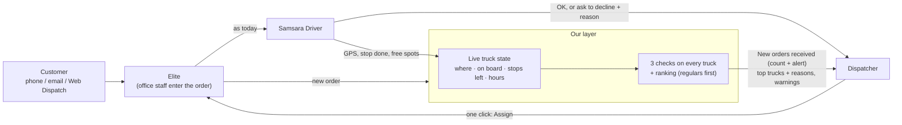
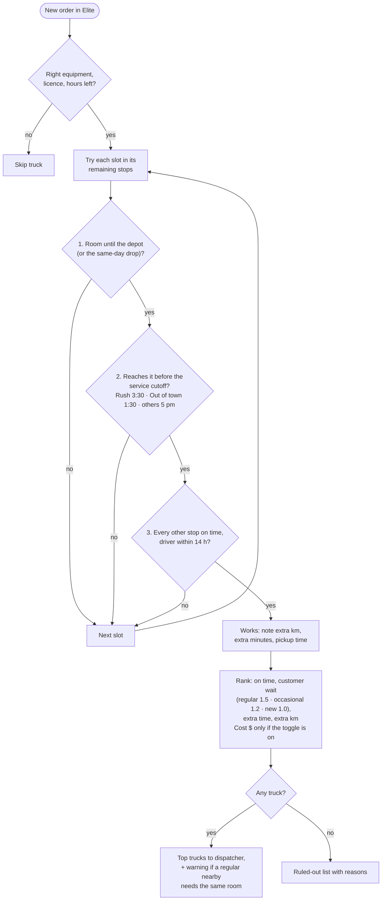
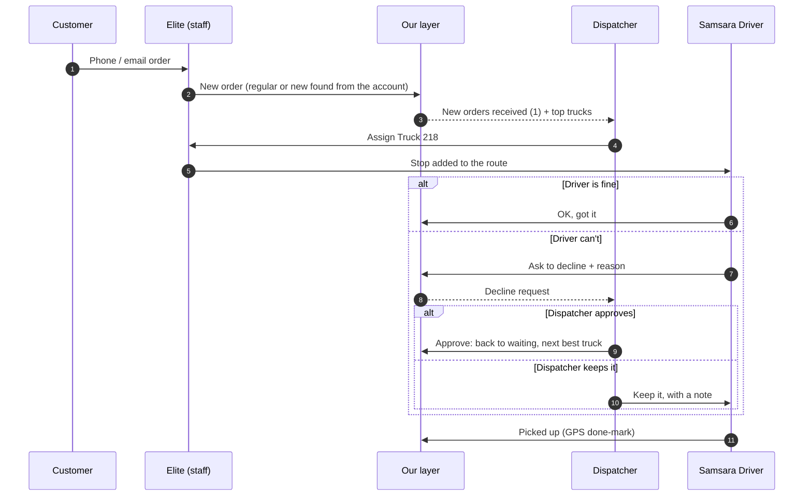
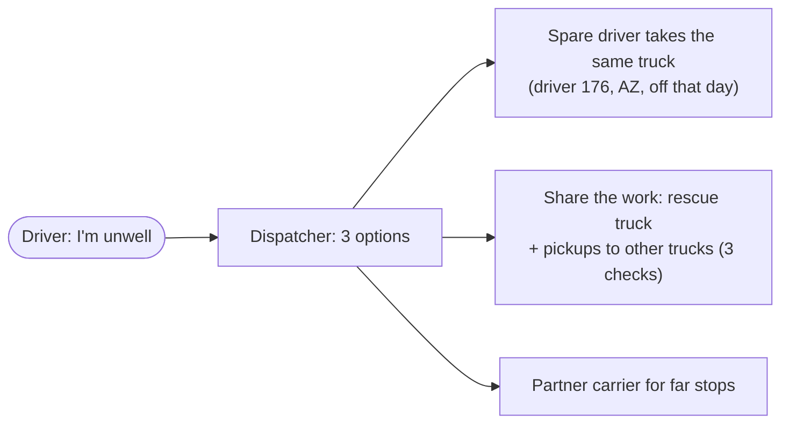
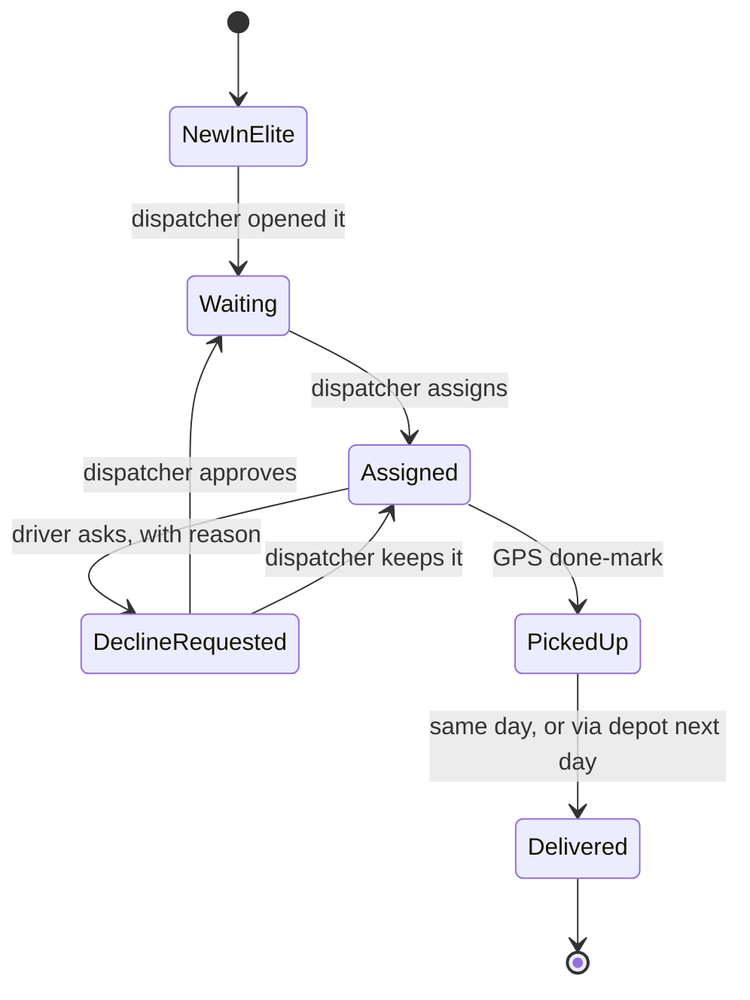

# Live pickup assignment — diagrams (current design)
**The one rule:** a truck takes a new pickup only if it has room at that moment, can reach it before the service cutoff, and every other customer stays on time. The dispatcher always decides.

## 1. The big picture

Orders keep coming the way they do today. Nothing is typed twice.

## 2. Can this truck take the pickup?

## 3. One order, start to finish

## 4. Driver called in sick

## 5. Life of an order

## 6. Next
Real road distances and traffic · customer email updates · AI photo → free floor spots (in development) · live Elite and Samsara connection.
